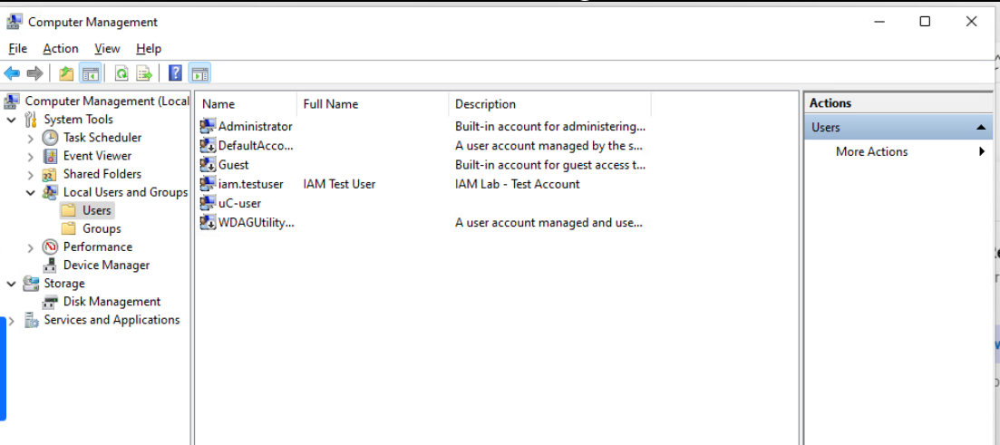
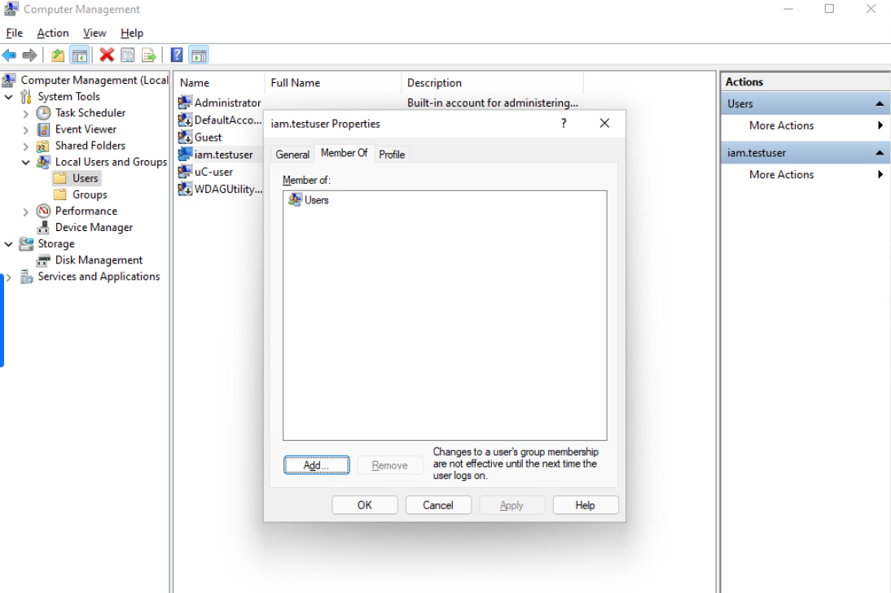
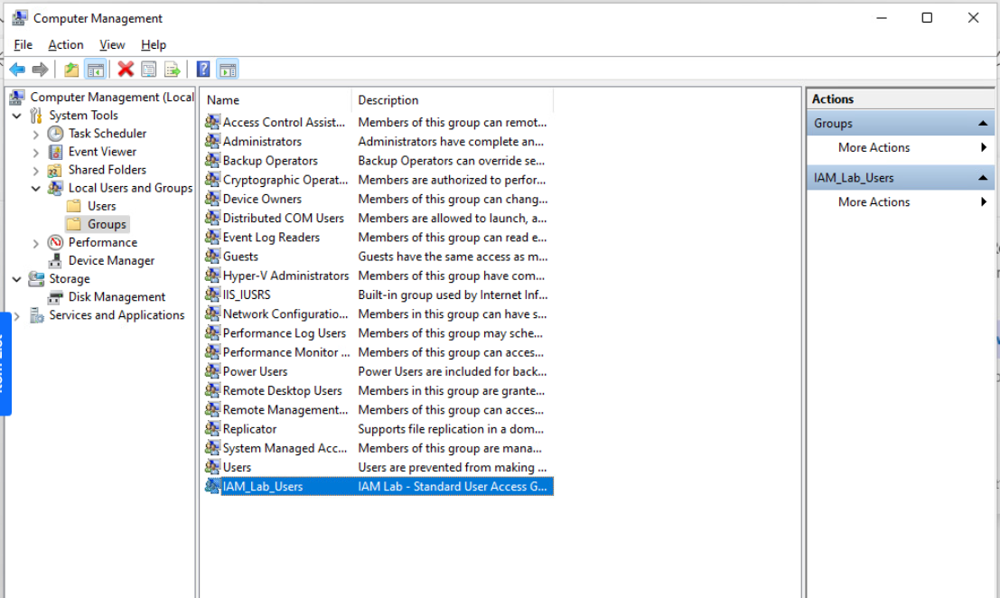
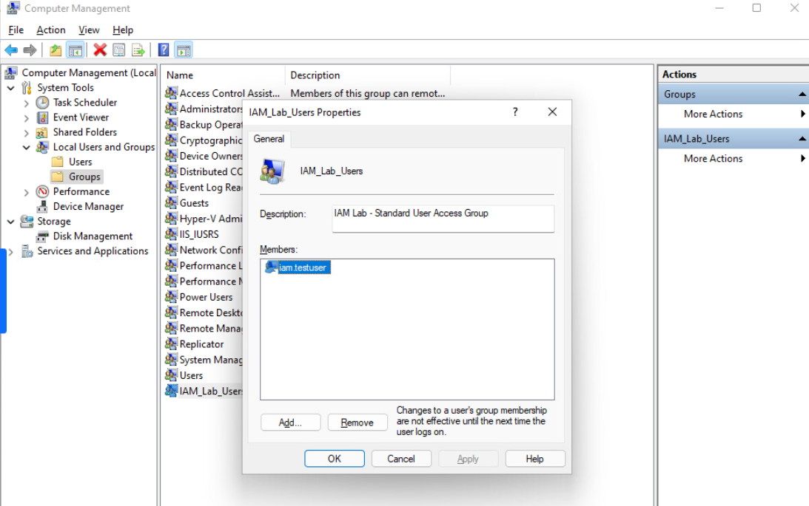
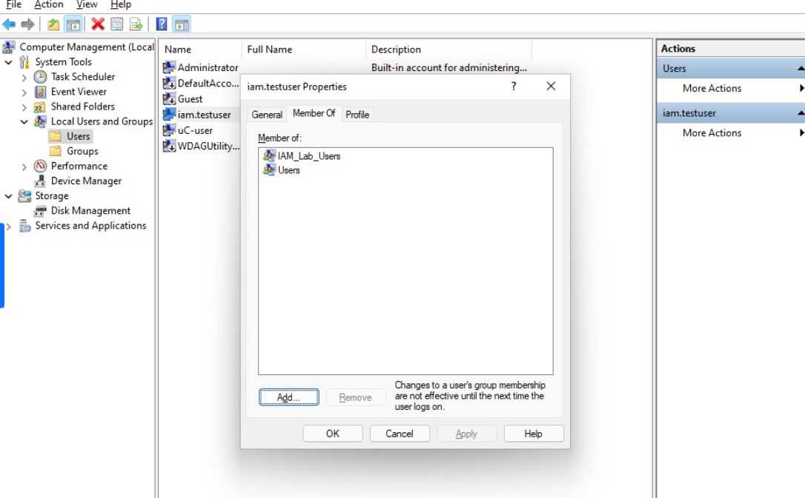
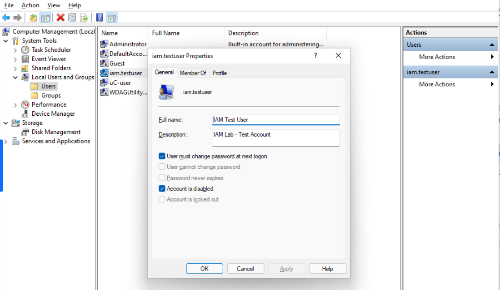

# Windows Local IAM Lab

## Project Overview

This project demonstrates my hands-on experience with Identity and Access Management (IAM) using Windows Computer Management. I completed this lab to practice creating user accounts, managing security groups, applying least-privilege principles, and disabling accounts during employee offboarding.

The lab was performed in a Windows school lab environment using Local Users and Groups. It focuses on local account management rather than Active Directory domain administration.

## Tools Used

- Windows Computer Management
- Local Users and Groups
- Windows User Account Management
- Local Security Groups

## Lab Objectives

- Create and configure a local user account.
- Create a security group for access management.
- Assign a user to the security group.
- Verify group membership and least-privilege access.
- Disable a user account to simulate employee offboarding.

## Lab Implementation

### 1. User Provisioning

I created a local Windows account named `iam.testuser` with the description "IAM Lab - Test Account." I also selected the option requiring the user to change their password at the next login.

### 2. Security Group Creation

I created a local security group named `IAM_Lab_Users` to practice managing access through group membership.

### 3. Group Membership Management

I added `iam.testuser` to the `IAM_Lab_Users` security group and verified that the membership was successfully applied.

### 4. Least-Privilege Verification

I reviewed the user's group membership and confirmed that the account belonged to the standard `Users` group and the `IAM_Lab_Users` group, without administrator membership.

### 5. Account Deprovisioning

I simulated employee offboarding by disabling the `iam.testuser` account. I verified that the "Account is disabled" setting was selected.

## Skills Demonstrated

- Identity and Access Management (IAM)
- User Provisioning and Deprovisioning
- Local Security Group Management
- Group Membership Verification
- Least-Privilege Access Control
- Windows Account Administration

## Conclusion

This lab helped me gain practical experience with managing Windows user accounts and security groups. I learned how account provisioning, access verification, and deprovisioning support organizational security. These skills provide a foundation for more advanced IAM work with Active Directory and Microsoft Entra ID.

## Screenshots

## Screenshots

### 1. User Account Creation

### 2. Standard User Membership

### 3. Security Group Creation

### 4. User Added to Security Group

### 5. Group Membership Verification

### 6. Account Deactivation

